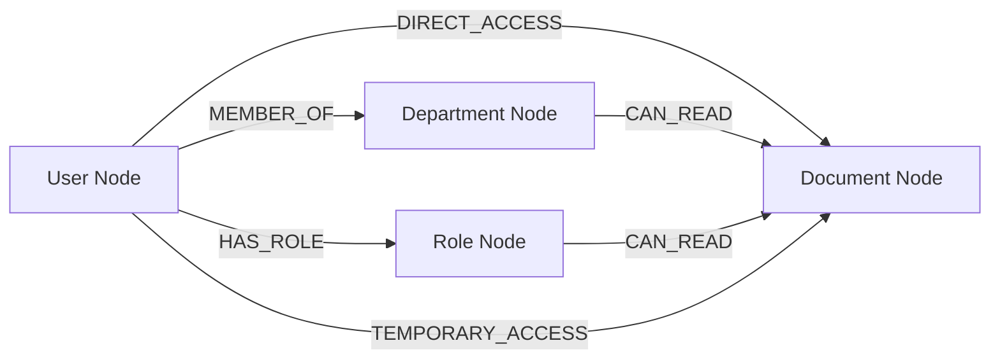

# Graph-RAG with Multi-Layer Access Control (Secure Enterprise Document Studio)

A production-grade, multi-tenant Retrieval-Augmented Generation (RAG) platform with **Graph-based Access Control (Graph-RAG)**, **multi-layer authorization (RBAC, DBAC, and User-level direct access)**, **Redis high-performance caching**, and **Google Gemini LLM synthesis**.

Before any vector search is executed, user permissions are verified and resolved via Neo4j graph traversal (cached in Redis). Only the exact document IDs authorized for that user are injected into Qdrant vector filters (`document_id IN allowed_ids`), ensuring **zero cross-document leakage** at the data layer.

---

## 🌟 Key Features

- **Multi-Layer Graph Authorization (Graph-RAG)**:
  - **Direct User Access**: Assign specific confidential documents directly to individual users.
  - **Role-Based Access Control (RBAC)**: Assign documents to roles (e.g. *Auditor*, *Security Engineer*, *Manager*) and users to roles.
  - **Department-Based Access Control (DBAC)**: Assign documents to departments (e.g. *Engineering*, *Finance*, *Legal*) and users to departments.
  - **Zero Default Access**: Newly registered accounts start with 0 document access, 0 roles, and 0 departments until explicitly provisioned by an administrator.
- **Multi-Tier Redis Caching Engine**:
  - **Graph Authorization Cache**: Resolves Neo4j permission checks in `<1ms`, eliminating graph database bottlenecks on repeated searches.
  - **Query Vector Cache**: Caches query embedding vectors in Redis, saving Gemini API quota.
  - **Search Synthesis Cache**: Caches grounded answers for identical queries within the same permission scope with sub-20ms latency.
  - **Automatic Invalidation**: Automatically purges relevant cache entries whenever permissions, documents, roles, or departments are updated.
- **Gemini Rate Limit (HTTP 429) Resilient Pipeline**:
  - **Batch Embedding Ingestion**: Chunks are embedded in optimized batches (up to 16 chunks/call via `embed_documents`) instead of individual sequential requests.
  - **Exponential Backoff**: Automatic retries with exponential backoff on `RESOURCE_EXHAUSTED` / 429 quota spikes.
  - **Extractive Fallback**: If the live LLM is completely unavailable, the engine falls back to extractive source grounding rather than crashing.
  - **Runtime API Key Hot-Reloading**: Swap exhausted Gemini API keys directly from the Admin UI or API without restarting Docker containers.
- **ChatGPT / Gemini Style Conversational Interface**:
  - **Left Sidebar**: Collapsible history drawer with `+ New Chat` button, real-time thread list, active chat highlighting, and deletion controls.
  - **Persistent PostgreSQL Storage**: All conversations, questions, assistant responses, citations, and authorized document metrics are permanently stored in PostgreSQL tables (`chat_sessions` and `chat_messages`).
  - **Interactive Message Stream**: User bubbles, assistant bubbles with custom markdown parsing (lists, bold text, headers, and clickable citation badges), inline citation cards, and animated thinking indicators.
- **Strict Vector Isolation**:
  - Authorized document IDs are resolved *server-side* and injected into Qdrant payload filters (`document_id IN allowed_ids` and `tenant_id == tenant`). Un-authorized vectors are never retrieved or passed to the LLM.
- **Interactive Admin Console & View Switcher**:
  - Four dedicated management tabs: **Documents**, **Users**, **Departments**, and **Roles**.
  - Document detail view to assign/remove direct users, departments, and roles.
  - User detail view to inspect effective graph-derived document permissions and toggle memberships.
  - Header toggle for administrators to switch between the **Admin Console** and the **Knowledge Chat Studio**.

---

## 🛠️ Technologies Used

| Component | Technology | Role & Purpose |
| :--- | :--- | :--- |
| **Frontend** | React 18, TypeScript, Vite, Nginx | Responsive dark-theme dashboard, admin management console, citation badges, inline markdown formatter. |
| **Backend API** | FastAPI, Python 3.12, Uvicorn, Pydantic v2 | High-concurrency async REST API, JWT authentication, PDF chunking, pipeline orchestration. |
| **Relational DB** | PostgreSQL 16, SQLAlchemy, Psycopg 3 | User account credentials, bcrypt password hashing, tenant mapping, admin privilege flags. |
| **Graph Database** | Neo4j 5 Community | Directed property graph modeling users, roles, departments, documents, and access edges. |
| **Vector Database** | Qdrant v1.13 | High-performance vector index (Cosine distance, HNSW indexing) with payload filtering. |
| **Cache Engine** | Redis 7 (Alpine) | In-memory caching for Neo4j permissions, query embeddings, and LLM synthesis answers. |
| **LLM & Embeddings** | Google Gemini & LangChain | `gemini-3.6-flash` for grounded synthesis and `gemini-embedding-001` for vectorization. |
| **Orchestration** | Docker & Docker Compose | Containerized multi-service deployment with integrated health checks. |

---

## 🏗️ System Architecture & Data Flow

```
                                  ┌───────────────────────────┐
                                  │   React 18 Single-Page    │
                                  │      Application          │
                                  └─────────────┬─────────────┘
                                                │ 1. Search Query + JWT
                                                ▼
                                  ┌───────────────────────────┐
                                  │    FastAPI Application    │
                                  └──────┬─────────────┬──────┘
                                         │             │
                    2. Check Auth Cache  │             │ 3. If Cache Miss:
                    (allowed_docs)       │             │    Traverse Relationships
                                         ▼             ▼
                                  ┌─────────────┐   ┌────────────────────────┐
                                  │ Redis 7     │   │ Neo4j Graph Database   │
                                  │ Cache       │   │ (User->Role->Doc)      │
                                  └─────────────┘   │ (User->Dept->Doc)      │
                                         ▲          │ (User->Direct->Doc)    │
                     Store with TTL=300s └──────────┴───────────┬────────────┘
                                                                │
                                         ┌──────────────────────┘
                                         │ 4. allowed_doc_ids
                                         ▼
                                  ┌───────────────────────────┐
                                  │  Check Query Vector Cache │ (Redis: embed:text)
                                  └──────────────┬────────────┘
                                                 │
                                                 │ 5. Filtered Vector Search
                                                 ▼ (document_id IN allowed_doc_ids)
                                  ┌───────────────────────────┐
                                  │    Qdrant Vector DB       │
                                  └──────────────┬────────────┘
                                                 │ 6. Top-K Authorized Chunks
                                                 ▼
                                  ┌───────────────────────────┐
                                  │    Google Gemini Flash    │
                                  │      LLM Synthesis        │
                                  └──────────────┬────────────┘
                                                 │ 7. Grounded Answer + Citations
                                                 ▼ (Cached in Redis: search:answer)
                                  ┌───────────────────────────┐
                                  │   Formatted Response      │
                                  └───────────────────────────┘
```

---

## 🔐 Multi-Layer Access Control Model

Authorization is modeled as a directed property graph in Neo4j with 3 distinct pathways to a Document node:



When resolving a user's permissions, the Cypher query evaluates:

1. **Direct Access**: `(u:User)-[:DIRECT_ACCESS]->(d:Document)`
2. **Department Membership**: `(u:User)-[:MEMBER_OF]->(dept:Department)-[:CAN_READ]->(d:Document)`
3. **Role Assignment**: `(u:User)-[:HAS_ROLE]->(r:Role)-[:CAN_READ]->(d:Document)`
4. **Temporary Access**: `(u:User)-[a:TEMPORARY_ACCESS]->(d:Document) WHERE a.expires_at > datetime()`

The union of all accessible document IDs is returned as `allowed_ids`.

---

## ⚡ Redis Multi-Tier Caching System

To ensure minimal latency and prevent hitting rate limits, Redis is utilized across three tiers:

### 1. Graph Authorization Cache
- **Key Pattern**: `auth:allowed_docs:{tenant_id}:{user_id}`
- **TTL**: 300 seconds (5 minutes).
- **Impact**: Reduces permission resolution time from ~15-30ms (Neo4j roundtrip) to `<1ms` (in-memory lookup).
- **Invalidation**: Whenever an admin adds/removes permissions, documents, departments, or roles, the corresponding tenant and user auth keys are automatically purged.

### 2. Query Embedding Vector Cache
- **Key Pattern**: `embed:text:{sha256(text)}`
- **TTL**: 86,400 seconds (24 hours).
- **Impact**: If multiple users ask the same or similar questions, the query vector is fetched from Redis, completely bypassing the Google Generative AI Embedding API.

### 3. Search Synthesis Response Cache
- **Key Pattern**: `search:answer:{tenant_id}:{sha256(query + "||" + sorted(allowed_ids))}`
- **TTL**: 600 seconds (10 minutes).
- **Impact**: Provides instantaneous answers (<20ms) for repeated queries while ensuring strict multi-tenant and permission isolation (users with different permissions will never share the same cache entry).

---

## 🛑 Gemini API Rate Limiting (429) & Mitigations

### Why HTTP 429 "Too Many Requests" Occurs
Google AI Studio's Gemini free tier imposes strict rate limits:
- **15 RPM (Requests Per Minute)** for Gemini Flash.
- **1,500 RPD (Requests Per Day)**.

In naive RAG implementations, uploading a 10-page PDF generates 30–50 chunks. If embedded sequentially in a tight loop, 50 requests hit Google within 2 seconds, immediately exhausting the 15 RPM limit and triggering `429 ResourceExhausted`.

### How This Platform Prevents 429 Errors

1. **Batch Ingestion (`embed_documents`)**:
   - Rather than sending single chunks, the ingestion pipeline batches up to 16 chunks per API call (`batchEmbedContents`). A 48-chunk document requires only 3 API calls instead of 48.
2. **Exponential Backoff**:
   - Both embedding and chat calls feature automatic retry logic with backoff (`2s -> 4s -> 8s`), allowing temporary quota bursts to clear automatically.
3. **Chunk Vector Caching**:
   - Chunks already embedded are cached in Redis (`TTL = 7 days`). Re-indexing or re-processing chunks requires 0 API calls.
4. **Runtime API Key Hot-Reloading**:
   - If an API key hits its daily limit (1,500 RPD), the admin can paste a new key in the Admin Console header banner. The backend reloads both embedding and chat clients in memory without restarting any containers.

---

## 🚀 Getting Started

### Prerequisites

- **Docker & Docker Compose** installed and running on your system.
- A **Google Gemini API Key** from [Google AI Studio](https://aistudio.google.com/).

### Configuration

1. Create a `.env` file from `.env.example`:
   ```bash
   cp .env.example .env
   ```

2. Configure your environment variables in `.env`:
   ```env
   POSTGRES_DB=rag_auth
   POSTGRES_USER=rag_user
   POSTGRES_PASSWORD=change-me-in-production
   JWT_SECRET=your-random-secret-key-at-least-32-characters

   ADMIN_EMAIL=admin@example.com
   ADMIN_PASSWORD=AdminTitan!2026
   ADMIN_DISPLAY_NAME=System Admin

   SEED_USER_ONE_EMAIL=user.one@example.com
   SEED_USER_ONE_PASSWORD=TitanUserOne!2026

   SEED_USER_TWO_EMAIL=user.two@example.com
   SEED_USER_TWO_PASSWORD=TitanUserTwo!2026

   GOOGLE_API_KEY=your_gemini_api_key_here
   GEMINI_CHAT_MODEL=gemini-3.6-flash
   GEMINI_EMBEDDING_MODEL=models/gemini-embedding-001
   GEMINI_TEMPERATURE=0.7
   CORS_ORIGINS=http://localhost:5173
   REDIS_URL=redis://redis:6379/0
   ```

---

## 🏃 Running the Application

### 1. Start All Services

Run the following command to build and start the containers in the background:

```bash
docker compose up -d
```

All 6 services will start up:
- `major_project1-postgres-1`
- `major_project1-neo4j-1`
- `major_project1-qdrant-1`
- `major_project1-redis-1`
- `major_project1-api-1`
- `major_project1-web-1`

### 2. Service Endpoints & Web UIs

| Service | URL | Default Credentials / Info |
| :--- | :--- | :--- |
| **Web Application** | [http://localhost:5173](http://localhost:5173) | Main UI (Admin Console / User Knowledge Desk) |
| **FastAPI Backend** | [http://localhost:8000](http://localhost:8000) | REST API |
| **API Docs (Swagger)** | [http://localhost:8000/docs](http://localhost:8000/docs) | Interactive API documentation |
| **Neo4j Browser** | [http://localhost:7474](http://localhost:7474) | User: `neo4j` / Password: `neo4j-local-password` |
| **Qdrant Dashboard** | [http://localhost:6333/dashboard](http://localhost:6333/dashboard) | Vector collection inspector |
| **Redis CLI** | `docker exec -it major_project1-redis-1 redis-cli` | Direct Redis inspection |

### 3. Stopping Services

To stop running containers without losing data:
```bash
docker compose down
```

To stop containers and **wipe all persistent volumes** (PostgreSQL, Neo4j, Qdrant, Redis):
```bash
docker compose down -v
```

---

## 👥 Default Accounts

| Account | Email | Password | Role / Access |
| :--- | :--- | :--- | :--- |
| **System Admin** | `admin@example.com` | `AdminTitan!2026` | Full administrative control (Documents, Users, Departments, Roles, API Key reload). |
| **User One** | `user.one@example.com` | `TitanUserOne!2026` | Standard user account. |
| **User Two** | `user.two@example.com` | `TitanUserTwo!2026` | Standard user account. |

> **Note**: New user accounts created via the **Create Account** button on the sign-in page will start with **0 document access, 0 departments, and 0 roles** by default.

---

## 🧪 Admin Console Walkthrough

Log in as `admin@example.com` to access the Admin Console with 4 primary management tabs:

1. **📄 Documents**:
   - Upload PDF files (with optional initial email/department/role tags).
   - View all indexed documents with real-time access tags.
   - Click any document to edit directly assigned user emails, allowed departments, and allowed roles.
   - Delete document: Removes graph node, relationships, and Qdrant vectors while invalidating cache.
2. **👥 Users**:
   - View all registered users.
   - Click a user to inspect their profile:
     - Toggle assigned departments.
     - Toggle assigned roles.
     - Toggle direct document access.
     - View the live list of **All Allowed Documents** derived via Neo4j graph resolution.
   - Delete non-admin user accounts.
3. **🏢 Departments**:
   - Create new departments (e.g. *Engineering*, *Finance*, *HR*, *Legal*).
   - Add/remove member users to the department.
   - Assign/remove accessible documents for that department.
   - Delete departments.
4. **🛡️ Roles**:
   - Create new roles (e.g. *Auditor*, *Team Lead*, *Support Agent*).
   - Add/remove member users to the role.
   - Assign/remove accessible documents for that role.
   - Delete roles.
5. **🔑 Hot-Reload Gemini API Key**:
   - At the top of the Admin Console, paste a new Google Gemini API key and click **Reload Key** (or press Enter).
   - The backend re-initializes the embedding and chat clients instantly in memory without taking containers down.

---

## 💡 Suggested Future Enhancements

The following architectural additions can be implemented to further extend this system:

### 1. Temporal ABAC (Time-Expiring Document Access)
- **Concept**: Grant a user access to a sensitive document that automatically expires after 24 hours, 7 days, or a specific calendar timestamp.
- **Implementation**:
  - The Neo4j graph already supports `[a:TEMPORARY_ACCESS {expires_at: datetime(...) }]->(d:Document)`.
  - Frontend: Add a "Grant Temporary Access" picker with duration presets (1 hr, 24 hr, 7 days, Custom Date).
  - Redis: Set key expiration TTL matching the nearest expiration timestamp so cached authorization automatically reflects expiry.

### 2. Conversational Memory & Multi-Turn Chat History
- **Concept**: Allow users to ask follow-up questions (e.g., *"Can you summarize point 2?"* or *"Compare this with the rollback procedure"*).
- **Implementation**:
  - Store conversation turns in Redis under `chat_session:{user_id}:{session_id}` as a JSON list of `{"role": "user"|"model", "content": "..."}`.
  - Implement a sliding window of the last $N$ turns (e.g., 5 exchanges) into the LangChain prompt template.
  - Set a session TTL (e.g., 2 hours of inactivity) in Redis.

### 3. Semantic Vector Caching (Redis Semantic Cache)
- **Concept**: Return cached answers not only for exact text string matches, but also for queries that are semantically identical (e.g., *"What is Docker?"* vs *"Explain what Docker is"*).
- **Implementation**:
  - When a query is embedded, compute cosine similarity against previously cached query vectors in Redis or Qdrant.
  - If similarity exceeds a threshold (e.g., $>0.96$), serve the cached synthesis directly, saving LLM calls.

### 4. Cross-Encoder Re-Ranking
- **Concept**: Enhance retrieval precision by re-ranking top-K vector results before sending them to Gemini.
- **Implementation**:
  - Retrieve top 12 chunks from Qdrant, pass them through a lightweight cross-encoder (e.g., FlashRank or BGE-Reranker-v2), and forward only the top 4 most relevant chunks to Gemini.
  - Reduces prompt token usage while improving answer precision.

### 5. Audit Logging & Security Compliance Analytics
- **Concept**: Enterprise audit trail tracking document access patterns, query history, and permission denials.
- **Implementation**:
  - Log every `/search` request with `user_id`, `timestamp`, `query`, `retrieved_docs`, and `cache_hit` flag to PostgreSQL or an append-only Redis Stream (`XADD`).
  - Provide an Admin Audit dashboard showing which documents are most frequently queried and identifying any unauthorized access attempts.
